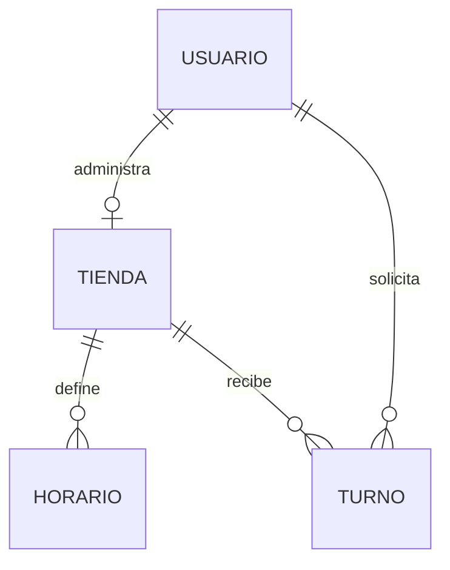

# Documento funcional — Turno Ya

**Sistema:** Turno Ya - Gestión de turnos de atención
**Integrante:** Romero Bernardo Nahuel
**Repositorio:** `YA-PNT-12C-ROMERO`
**Versión:** 1.3.0

---

## Índice

1. Introducción
2. Alcance
3. Actores y roles
4. Casos de uso
5. Flujos funcionales
6. Estados y reglas de negocio del turno
7. Requisitos funcionales
8. Requisitos no funcionales
9. Pantallas
10. Validaciones y mensajes de error
11. Matriz de permisos
12. Interfaz de servicios (API REST)
13. Modelo de datos
14. Arquitectura (MVC)
15. Supuestos y restricciones

---

## 1. Introducción

### 1.1 Propósito

Este documento describe qué hace Turno Ya desde el punto de vista del usuario: actores, casos de uso, reglas de negocio, pantallas y servicios. Es la referencia funcional del sistema.

### 1.2 Objetivo del sistema

Centralizar la reserva y administración de turnos entre múltiples tiendas y sus clientes. Evita superposiciones de turnos, reduce la atención manual y da visibilidad sobre la agenda diaria y las estadísticas globales.

### 1.3 Visión general

- Una **landing pública** (`index.html`) explica el proyecto y muestra las tiendas disponibles con sus horarios.
- Toda acción que requiere cuenta (pedir turno, registrarse, administrar) lleva al **login** (`login.html`).
- Tras autenticarse, el usuario accede a su **panel** (`app.html`) según su rol: cliente, administrador de tienda o super administrador.

## 2. Alcance

**Incluye:**

- Landing pública con descripción del sistema y tiendas disponibles.
- Registro e inicio de sesión por rol.
- Alta de tienda (junto con el registro del administrador) y edición de su perfil y foto.
- Definición de horarios de atención.
- Solicitud y cancelación de turnos.
- Gestión del ciclo de vida del turno (aceptar, rechazar, marcar como realizado, cancelar).
- Gestión de perfil (nombre, foto, contraseña).
- Estadísticas globales y administración de usuarios (alta, baja y modificación).

**No incluye:**

- Pagos en línea.
- Envío de correos o mensajes automáticos.
- Integración con calendarios externos.
- Múltiples sucursales por tienda.
- Recuperación de contraseña por correo.

## 3. Actores y roles

| Actor                   | Rol en el sistema | Descripción                                                                                           |
| ----------------------- | ----------------- | ------------------------------------------------------------------------------------------------------ |
| Visitante               | Sin sesión       | Ve la landing y las tiendas con sus horarios. No puede operar.                                         |
| Cliente                 | `CLIENTE`       | Se registra, solicita y cancela sus turnos y gestiona su perfil.                                       |
| Administrador de tienda | `ADMIN`         | Se registra con su tienda, define horarios, atiende la agenda y edita la tienda y su perfil.           |
| Super administrador     | `SUPER_ADMIN`   | Se crea automáticamente al iniciar el sistema (no se registra). Ve estadísticas y gestiona usuarios. |

## 4. Casos de uso

| ID   | Caso de uso           | Actor                   | Descripción breve                                           |
| ---- | --------------------- | ----------------------- | ------------------------------------------------------------ |
| CU01 | Ver landing y tiendas | Visitante               | Conoce el sistema y consulta tiendas y horarios sin sesión. |
| CU02 | Registrarse           | Visitante               | Crea una cuenta de cliente o de administrador (con tienda).  |
| CU03 | Iniciar sesión       | Todos                   | Se autentica con usuario y contraseña y accede a su panel.  |
| CU04 | Cerrar sesión        | Usuario autenticado     | Termina la sesión y vuelve a la landing.                    |
| CU05 | Consultar tiendas     | Cliente                 | Ve las tiendas activas con foto, descripción y horarios.    |
| CU06 | Solicitar turno       | Cliente                 | Elige tienda, fecha, horario y servicio.                     |
| CU07 | Ver mis turnos        | Cliente                 | Lista sus turnos y su estado.                                |
| CU08 | Cancelar turno        | Cliente                 | Cancela un turno propio no realizado.                        |
| CU09 | Definir horarios      | Administrador           | Agrega o elimina horarios de atención.                      |
| CU10 | Consultar agenda      | Administrador           | Ve los turnos de su tienda, con filtro por estado y resumen. |
| CU11 | Gestionar turno       | Administrador           | Acepta, rechaza, marca como realizado o cancela.             |
| CU12 | Editar tienda         | Administrador           | Modifica datos y foto de su tienda.                          |
| CU13 | Gestionar perfil      | Cliente / Administrador | Edita nombre, foto y contraseña.                            |
| CU14 | Ver estadísticas     | Super administrador     | Consulta totales de usuarios, tiendas y turnos.              |
| CU15 | Gestionar usuarios    | Super administrador     | Crea, edita y elimina usuarios de cualquier rol.             |

## 5. Flujos funcionales

### 5.1 Navegación desde la landing (CU01)

**Precondición:** ninguna.

1. El visitante ingresa a `index.html` y lee qué es Turno Ya y cómo funciona.
2. Explora las tiendas disponibles (foto, descripción, dirección y horarios).
3. Al presionar "Pedir turno", "Ingresar", "Crear cuenta" o "Registrar mi tienda" es enviado a `login.html`. Si ya tenía sesión, va directo a `app.html`.

**Resultado:** solo se puede operar con sesión iniciada.

### 5.2 Registro (CU02)

**Precondición:** el visitante está en `login.html`.

1. Completa nombre de usuario, correo, contraseña y nombre completo.
2. Elige el tipo de cuenta: cliente o administrador. Si elige administrador, indica el nombre de su tienda.
3. El sistema valida los datos, crea la cuenta (y la tienda si corresponde) e inicia sesión.

**Resultado:** el usuario queda autenticado y es llevado a `app.html`.
**Alternativas:** si el usuario o el correo ya existen, o algún dato es inválido, se muestra un error y no se crea la cuenta.

### 5.3 Inicio de sesión (CU03)

1. El usuario ingresa usuario y contraseña.
2. El sistema valida las credenciales y que la cuenta esté activa.
3. Devuelve un token JWT que el navegador guarda para las siguientes consultas.
4. Se redirige a `app.html`, que muestra el panel del rol.

**Alternativas:** credenciales incorrectas o cuenta inactiva muestran un error. Si el token vence o es inválido, el sistema cierra la sesión y redirige a `login.html`.

### 5.4 Solicitud de turno (CU06)

**Precondición:** sesión de cliente.

1. En la pestaña "Tiendas disponibles" ve las tiendas activas.
2. Presiona "Pedir turno": se abre una pantalla ampliada con foto, descripción, dirección y horarios.
3. Elige fecha, horario y servicio.
4. El sistema verifica los datos obligatorios, que la fecha y hora no hayan pasado y que el horario esté libre en esa tienda.
5. El turno se registra en estado **Pendiente**.

**Resultado:** el turno aparece en "Mis turnos" del cliente y en la agenda de la tienda.

### 5.5 Cancelación de turno (CU08)

1. El cliente ubica el turno en "Mis turnos" y presiona cancelar.
2. El sistema cambia el estado a **Cancelado** y libera el horario.

**Restricción:** solo puede cancelar sus propios turnos y solo si no están realizados.

### 5.6 Definición de horarios (CU09)

**Precondición:** sesión de administrador.

1. Selecciona el día de la semana y el rango horario (desde/hasta).
2. El sistema valida que el inicio sea anterior al fin.
3. El horario queda visible públicamente en el perfil de la tienda.

También puede eliminar horarios existentes.

### 5.7 Gestión de turnos por el administrador (CU10, CU11)

1. Consulta la agenda de su tienda y puede filtrar por estado. Ve además un resumen por estado.
2. Sobre un turno **Pendiente**: lo acepta o lo rechaza.
3. Sobre un turno **Aceptado**: lo marca como realizado o lo cancela.

**Resultado:** el estado se actualiza y el cliente lo ve reflejado en "Mis turnos".

### 5.8 Edición de la tienda (CU12)

1. El administrador abre su tienda y modifica nombre, descripción y dirección.
2. Puede subir, cambiar o quitar la foto (PNG, JPG, GIF o WEBP, hasta 2 MB).

### 5.9 Gestión de perfil (CU13)

1. En "Mi perfil" modifica su nombre y/o sube una nueva foto.
2. Opcionalmente cambia la contraseña indicando la actual y la nueva.

**Resultado:** la contraseña solo cambia si la actual es correcta.

### 5.10 Estadísticas y usuarios (CU14, CU15)

1. El super administrador consulta usuarios totales, administradores, clientes, tiendas y turnos por estado.
2. En el listado de usuarios puede crear, editar (incluido rol y estado activo/inactivo) o eliminar cualquier usuario.

**Resultado:** los cambios se reflejan de inmediato en el listado y en las estadísticas.

## 6. Estados y reglas de negocio del turno

### 6.1 Estados

`PENDIENTE`, `ACEPTADO`, `RECHAZADO`, `REALIZADO`, `CANCELADO`.

### 6.2 Transiciones permitidas

| Estado actual        | Estados siguientes   | Quién                 |
| -------------------- | -------------------- | ---------------------- |
| Pendiente            | Aceptado, Rechazado  | Administrador          |
| Pendiente / Aceptado | Cancelado            | Cliente (propio turno) |
| Aceptado             | Realizado, Cancelado | Administrador          |

Cualquier otra transición es rechazada.

### 6.3 Reglas de negocio

- RN1: no puede haber dos turnos en la misma fecha y horario para una misma tienda.
- RN2: no se admiten turnos en el pasado, según la zona horaria `APP_TIME_ZONE` (por defecto `America/Argentina/Buenos_Aires`).
- RN3: un administrador tiene una única tienda.
- RN4: solo el administrador de la tienda gestiona sus horarios, su agenda y sus turnos.
- RN5: el super administrador no se registra públicamente.
- RN6: una tienda inactiva no acepta turnos.
- RN7: un usuario inactivo no puede iniciar sesión.

## 7. Requisitos funcionales

| ID   | Requisito                                                                             |
| ---- | ------------------------------------------------------------------------------------- |
| RF1  | Registro de cuentas como cliente o como administrador (con su tienda).                |
| RF2  | Inicio de sesión con sesión autenticada mediante token.                             |
| RF3  | Validar datos obligatorios y formato de correo y contraseña al registrarse.          |
| RF4  | El cliente visualiza las tiendas disponibles con sus horarios.                        |
| RF5  | El administrador define los horarios de atención de su tienda.                       |
| RF6  | El cliente solicita un turno indicando tienda, fecha, horario y servicio.             |
| RF7  | Impedir reservar un horario ya ocupado en esa tienda.                                 |
| RF8  | El administrador consulta la agenda de su tienda y la filtra por estado.              |
| RF9  | El administrador acepta, rechaza o marca como realizado cada turno.                   |
| RF10 | El cliente cancela sus turnos si aún no fueron realizados.                           |
| RF11 | Todo usuario autenticado gestiona su perfil: nombre, foto y contraseña.              |
| RF12 | El super administrador visualiza estadísticas globales.                              |
| RF13 | El super administrador da de alta, modifica y elimina usuarios de cualquier rol.      |
| RF14 | El administrador sube, cambia y quita la foto de su tienda.                           |
| RF15 | El cliente ve la foto de cada tienda y una pantalla ampliada al pedir turno.          |
| RF16 | Rechazar turnos con fecha y hora ya pasadas.                                          |
| RF17 | Landing pública con descripción del proyecto y tiendas disponibles, sin sesión.    |
| RF18 | Las acciones que requieren cuenta redirigen al login; el panel privado exige sesión. |

## 8. Requisitos no funcionales

| Categoría     | Requisito                                                                         |
| -------------- | --------------------------------------------------------------------------------- |
| Usabilidad     | Interfaz clara, adaptable a escritorio y móviles, con paneles por rol.           |
| Rendimiento    | Agenda y autenticación responden en menos de 2 segundos en condiciones normales. |
| Seguridad      | Contraseñas con BCrypt, API protegida con JWT y autorización por rol.           |
| Compatibilidad | Navegadores modernos, sin instalación adicional.                                 |
| Despliegue     | Contenedores Docker (frontend, backend y base de datos).                          |
| Arquitectura   | Patrón Modelo-Vista-Controlador.                                                 |
| Mantenibilidad | Código separado en capas con responsabilidades definidas.                        |

## 9. Pantallas

| Pantalla                     | Archivo        | Acceso          | Contenido                                                                                                |
| ---------------------------- | -------------- | --------------- | -------------------------------------------------------------------------------------------------------- |
| Landing                      | `index.html` | Público        | Presentación del proyecto, cómo funciona, tiendas con horarios y llamados a la acción hacia el login. |
| Login y registro             | `login.html` | Público        | Formulario de ingreso y de registro (cliente o administrador).                                           |
| Panel de cliente             | `app.html`   | `CLIENTE`     | Pestañas: tiendas disponibles, mis turnos y mi perfil. Pantalla ampliada para pedir turno.              |
| Panel de administrador       | `app.html`   | `ADMIN`       | Agenda con filtro y resumen, horarios, datos y foto de la tienda, y perfil.                              |
| Panel de super administrador | `app.html`   | `SUPER_ADMIN` | Estadísticas globales y tabla de usuarios con alta, edición y baja.                                    |

`app.html` carga solo la plantilla del rol autenticado. Las maquetas detalladas están en [entrega.md](./entrega.md).

## 10. Validaciones y mensajes de error

| Campo o acción       | Regla                                                                  |
| --------------------- | ---------------------------------------------------------------------- |
| Registro              | Usuario, correo, contraseña y nombre completo obligatorios.           |
| Correo                | Formato válido y único.                                              |
| Contraseña           | Mínimo 8 caracteres.                                                  |
| Tienda (admin)        | Nombre obligatorio al registrarse como administrador.                  |
| Horario               | La hora de inicio debe ser anterior a la de fin.                       |
| Turno                 | Tienda, fecha, horario y servicio obligatorios; no pasado; no ocupado. |
| Foto de tienda        | PNG, JPG, GIF o WEBP, hasta 2 MB.                                      |
| Estado de turno       | Solo transiciones permitidas (sección 6.2).                           |
| Cancelación          | Solo turnos propios y no realizados.                                   |
| Cambio de contraseña | Requiere la contraseña actual correcta.                               |

Cuando una validación falla, el sistema muestra un mensaje de error al usuario y no modifica los datos.

## 11. Matriz de permisos

| Funcionalidad                              | Visitante | Cliente | Administrador | Super admin |
| ------------------------------------------ | :-------: | :-----: | :-----------: | :---------: |
| Ver landing, tiendas y horarios            |    Sí    |   Sí   |      Sí      |     Sí     |
| Registrarse / iniciar sesión              |    Sí    |   —   |      —      |     —     |
| Solicitar turno                            |    No    |   Sí   |      No      |     No     |
| Ver y cancelar mis turnos                  |    No    |   Sí   |      No      |     No     |
| Definir horarios                           |    No    |   No   |      Sí      |     No     |
| Ver agenda y gestionar turnos de la tienda |    No    |   No   |      Sí      |     No     |
| Editar la tienda propia                    |    No    |   No   |      Sí      |     No     |
| Editar perfil propio                       |    No    |   Sí   |      Sí      |     Sí     |
| Ver estadísticas globales                 |    No    |   No   |      No      |     Sí     |
| Gestionar usuarios                         |    No    |   No   |      No      |     Sí     |

## 12. Interfaz de servicios (API REST)

Todos los endpoints responden JSON. Salvo los marcados como públicos, requieren el encabezado `Authorization: Bearer <token>`.

| Método | Ruta                                 | Acceso          | Descripción                                          |
| ------- | ------------------------------------ | --------------- | ----------------------------------------------------- |
| GET     | `/`                                | Público        | Estado del servicio.                                  |
| POST    | `/api/auth/register`               | Público        | Registra un cliente o un administrador con su tienda. |
| POST    | `/api/auth/login`                  | Público        | Inicia sesión y devuelve el token.                   |
| GET     | `/api/tiendas`                     | Público        | Lista las tiendas activas.                            |
| GET     | `/api/tiendas/{tiendaId}/horarios` | Público        | Horarios de una tienda.                               |
| GET     | `/api/tiendas/mia`                 | `ADMIN`       | Datos de la tienda propia.                            |
| PUT     | `/api/tiendas/mia`                 | `ADMIN`       | Actualiza la tienda propia y su foto.                 |
| POST    | `/api/horarios`                    | `ADMIN`       | Crea un horario.                                      |
| DELETE  | `/api/horarios/{id}`               | `ADMIN`       | Elimina un horario.                                   |
| POST    | `/api/turnos`                      | `CLIENTE`     | Solicita un turno.                                    |
| GET     | `/api/turnos/mios`                 | `CLIENTE`     | Turnos del cliente.                                   |
| DELETE  | `/api/turnos/{id}`                 | `CLIENTE`     | Cancela un turno propio.                              |
| GET     | `/api/turnos/tienda`               | `ADMIN`       | Agenda de la tienda, con filtro por estado.           |
| GET     | `/api/turnos/tienda/resumen`       | `ADMIN`       | Resumen de turnos por estado.                         |
| PUT     | `/api/turnos/{id}/estado`          | `ADMIN`       | Cambia el estado de un turno.                         |
| GET     | `/api/usuarios/me`                 | Autenticado     | Perfil propio.                                        |
| PUT     | `/api/usuarios/me`                 | Autenticado     | Actualiza perfil propio.                              |
| GET     | `/api/admin/estadisticas`          | `SUPER_ADMIN` | Estadísticas globales.                               |
| GET     | `/api/admin/usuarios`              | `SUPER_ADMIN` | Lista usuarios.                                       |
| POST    | `/api/admin/usuarios`              | `SUPER_ADMIN` | Crea un usuario.                                      |
| PUT     | `/api/admin/usuarios/{id}`         | `SUPER_ADMIN` | Modifica un usuario.                                  |
| DELETE  | `/api/admin/usuarios/{id}`         | `SUPER_ADMIN` | Elimina un usuario.                                   |

Códigos habituales: `200` correcto, `400` datos inválidos, `401` sin sesión o token inválido, `403` sin permiso para el rol, `404` no encontrado, `409` conflicto (por ejemplo, horario ocupado).

## 13. Modelo de datos

### Usuario

| Atributo       | Tipo     | Descripción                              |
| -------------- | -------- | ----------------------------------------- |
| id             | Número  | Identificador único.                     |
| nombreUsuario  | Texto    | Usuario único para iniciar sesión.      |
| correo         | Texto    | Correo único.                            |
| passwordHash   | Texto    | Contraseña hasheada.                     |
| nombreCompleto | Texto    | Nombre y apellido.                        |
| imagenPerfil   | Texto    | Foto de perfil.                           |
| rol            | Texto    | `SUPER_ADMIN`, `ADMIN` o `CLIENTE`. |
| activo         | Booleano | Habilita o deshabilita la cuenta.         |

### Tienda

| Atributo     | Tipo        | Descripción                           |
| ------------ | ----------- | -------------------------------------- |
| id           | Número     | Identificador único.                  |
| nombre       | Texto       | Nombre del negocio.                    |
| descripcion  | Texto       | Descripción.                          |
| direccion    | Texto       | Dirección física.                    |
| imagenTienda | Texto largo | Foto en base64.                        |
| activa       | Booleano    | Indica si acepta turnos.               |
| idAdmin      | Número     | Usuario `ADMIN` dueño de la tienda. |

### Horario

| Atributo   | Tipo    | Descripción               |
| ---------- | ------- | -------------------------- |
| id         | Número | Identificador único.      |
| idTienda   | Número | Tienda a la que pertenece. |
| diaSemana  | Texto   | Lunes a domingo.           |
| horaInicio | Hora    | Inicio de la atención.    |
| horaFin    | Hora    | Fin de la atención.       |

### Turno

| Atributo  | Tipo    | Descripción                                           |
| --------- | ------- | ------------------------------------------------------ |
| id        | Número | Identificador único.                                  |
| idTienda  | Número | Tienda del turno.                                      |
| idCliente | Número | Usuario `CLIENTE` que lo solicita.                   |
| fecha     | Fecha   | Día de la atención.                                  |
| horario   | Hora    | Horario asignado.                                      |
| servicio  | Texto   | Tipo de atención.                                     |
| estado    | Texto   | Pendiente, aceptado, rechazado, realizado o cancelado. |

### Relaciones

- Un usuario `ADMIN` tiene una única tienda.
- Una tienda tiene muchos horarios y muchos turnos.
- Un cliente tiene muchos turnos.
- Cada turno pertenece a una tienda y a un cliente.

## 14. Arquitectura (MVC)

**Backend (Spring Boot, API REST):**

- Modelo: `model/` (entidades y enums), `repository/` (acceso a datos) y `service/` (reglas de negocio).
- Controlador: `controller/` expone los endpoints.
- Vista: `view/` define los DTOs JSON de entrada y salida.
- Transversales: `security/`, `config/` y `exception/`.

**Frontend (JavaScript plano):**

- Modelo: `js/models/` (`ApiClient`, `SessionModel`, `AuthModel`, `TiendaModel`, `TurnoModel`, `UsuarioModel`).
- Vista: `js/views/` y `templates/`, que renderizan el DOM sin llamar a la API.
- Controlador: `js/controllers/` (`LandingController`, `LoginController`, `AppController`, `ClienteController`, `TiendaAdminController`, `SuperAdminController`, `PerfilController`).

**Tecnologías:** Spring Boot 3.3, Java 17, MySQL, JWT, Docker, Apache para el frontend.

## 15. Supuestos y restricciones

- El super administrador se crea al iniciar el sistema con credenciales configurables por variables de entorno.
- La zona horaria de validación de turnos se define con `APP_TIME_ZONE`.
- Las fotos se guardan embebidas (base64) en la base de datos.
- El sistema se usa desde navegadores modernos con JavaScript habilitado.
- No hay notificaciones: el cliente consulta el estado de su turno en "Mis turnos".
